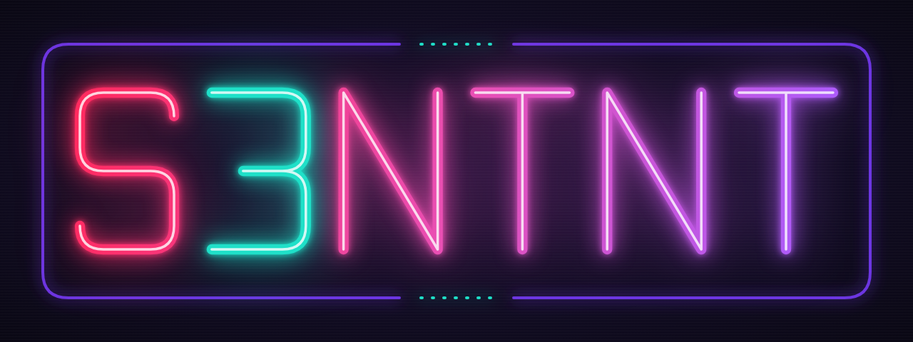
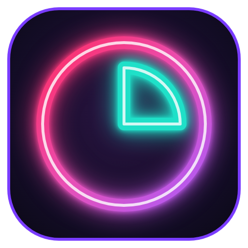
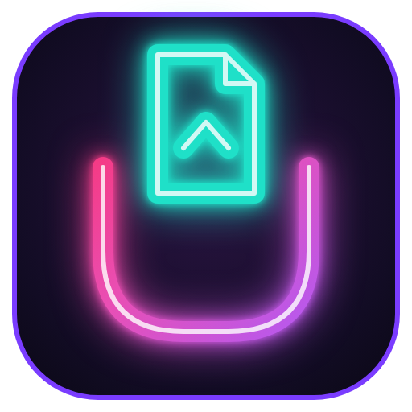

Neon-styled tools for Windows.

## Apps

| | |
|:-:|---|
|  | **[Neon Disk Management](https://github.com/S3ntnt47/neon-disk-management)**: a simple partition manager. Shrink, extend, create and delete partitions. |
|  | **Neon Undelete**: recovers deleted files from NTFS, FAT and exFAT drives. |

## Brand files

| File | Use |
|---|---|
| [`art/logo.svg`](art/logo.svg) / [`.png`](art/logo.png) | Banner logo with frame, 1280×480 |
| [`art/wordmark.svg`](art/wordmark.svg) / [`.png`](art/wordmark.png) | Wordmark only, transparent background |
| [`art/avatar.svg`](art/avatar.svg) / [`.png`](art/avatar.png) | "S3" monogram, 512×512, for profile pictures |
| [`apps/`](apps) | App icons (SVG source + 512 px PNG) |

Colours: crimson `#ff2a5f` → magenta `#e94fb4` → violet `#a85cff`, teal accent `#1fe0c8`, background `#0c0a17`.

Re-render a PNG from its SVG with `tools\render-svg.ps1 <in.svg> <out.png> <width> [height]` (uses headless Edge so the glow filters come through).
